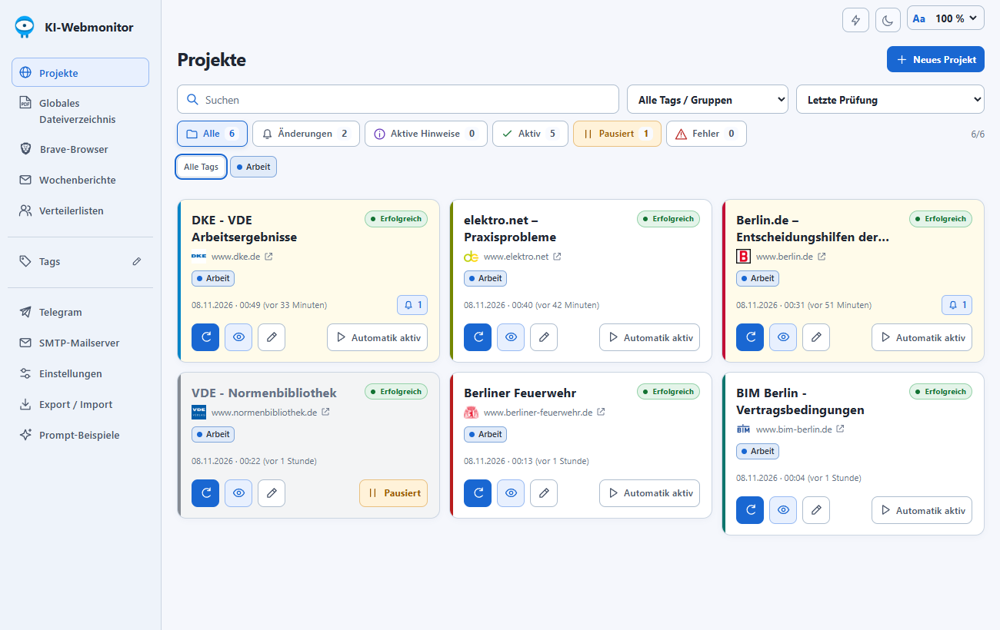
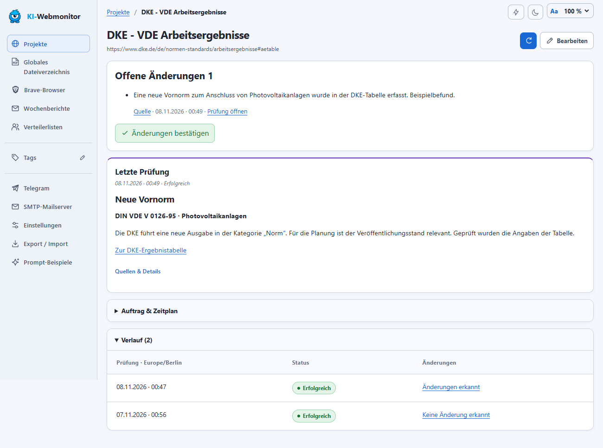
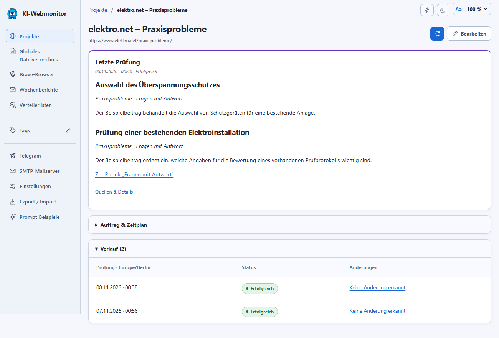
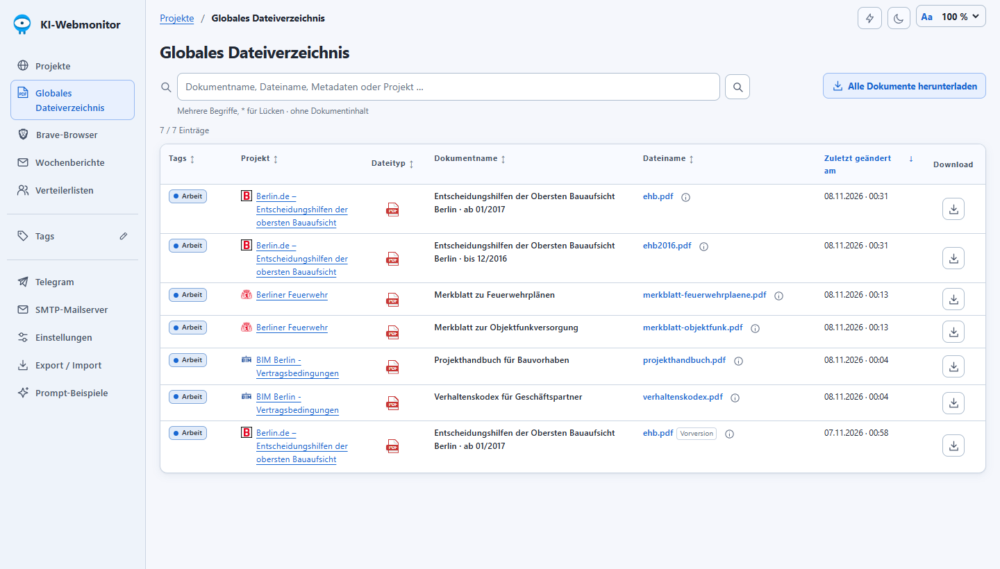
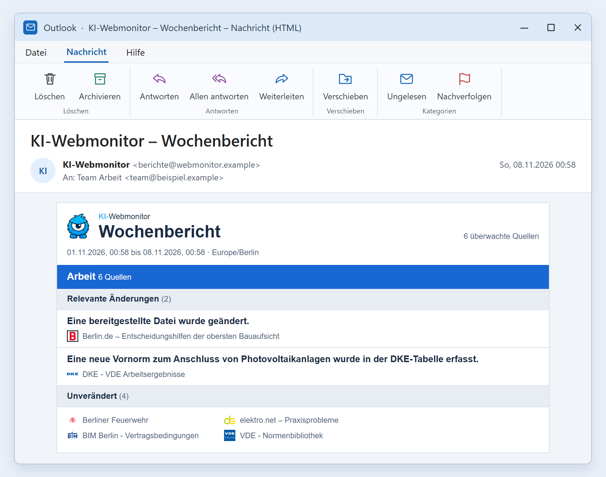

<p align="center">
  
</p>
<h1 align="center">KI-Webmonitor</h1>
<p align="center"><strong>Webseiten und Dokumente im Blick behalten</strong></p>

Der KI-Webmonitor prüft Webseiten und verlinkte Dateien nach einem Zeitplan. Du legst für jedes Projekt fest, welche Bereiche er prüfen und welche Änderungen er melden soll. Im Dashboard findest du die Ergebnisse mit Quellenlink und Prüfverlauf. Heruntergeladene Dateifassungen stehen im Archiv zum Vergleich bereit.

Web-App, Brave und Archiv laufen in Docker. Für die KI-Auswertung verbindet sich der Stack mit einem selbst betriebenen oMLX-Server über dessen OpenAI-kompatible API.



*Die Screenshots zeigen die App mit ausgewählten Arbeitsprojekten und Beispieldaten.*

## Ideen für eigene Projekte

Der Monitor eignet sich für Seiten, die du sonst regelmäßig von Hand prüfen würdest. Gib ihm die Adresse und beschreibe im Auftrag, was dich dort interessiert.

- **Termine und Fristen.** Lass dich informieren, wenn ein Kurs angekündigt wird, die Anmeldung öffnet oder sich eine Bewerbungsfrist verschiebt.
- **Preise und Verfügbarkeit.** Beobachte den angezeigten Preis eines Produkts oder prüfe, ob es wieder lieferbar ist.
- **Neue Beiträge und Angebote.** Sammle neue Artikel, Stellenanzeigen oder Ausschreibungen, die zu einem Thema passen.
- **Aktualisierte Unterlagen.** Prüfe, ob ein Formular, eine Preisliste oder eine Anleitung ausgetauscht wurde, auch wenn der Downloadlink gleich bleibt.

## Schnellstart in Portainer

Vorausgesetzt werden ein Linux-Docker-Host mit `amd64`, Docker Standalone und ein erreichbarer oMLX-Server für die KI-Funktionen. Portainer kann die fertigen Container-Images öffentlich aus GHCR laden.

1. **Stacks → Add stack → Git repository** öffnen. Als Stack-Namen beispielsweise `ki-webmonitor` verwenden.
2. Repository `https://github.com/adriantagonist87/KI-webmonitor.git` und Referenz `refs/tags/v1.5.12` eintragen. Die Repository-Anmeldung kann aus bleiben.
3. Für Zugriff über einen SSH-Tunnel `portainer-stack.yaml` wählen. Für Zugriff im LAN `portainer-lan-stack.yaml` verwenden und `KIWM_LAN_IP` sowie `KIWM_LAN_SUBNET` mit der Host-Adresse und dem eigenen Netz in CIDR-Schreibweise setzen.
4. Die folgenden Werte unter **Environment variables** hinterlegen. Den Adminnamen und ein eigenes Passwort mit mindestens zwölf Zeichen in Portainer eingeben.

   ```dotenv
   IMAGE_PREFIX=ghcr.io/adriantagonist87/ai-webmonitor
   VERSION=1.5.12
   KIWM_ADMIN_USERNAME=
   KIWM_ADMIN_PASSWORD=
   ```

5. Den Stack starten. Im LAN die Adresse `http://<DOCKER-HOST>:8765/` öffnen oder über den SSH-Tunnel `http://localhost:8765/` aufrufen.
6. Unter **Einstellungen** die oMLX-Adresse, den API-Token und das Modell hinterlegen und die Verbindung testen. Dieselben Werte können als `KIWM_OMLX_URL`, `KIWM_OMLX_API_KEY` und `KIWM_MODEL` in Portainer gesetzt werden. Nichtleere ENV-Werte haben Vorrang vor den Einstellungen in der App. Für Text, Tool Calling und Vision lassen sich bei Bedarf getrennte Modelle wählen.

Die veröffentlichten Containerpakete behalten den Pfad `ai-webmonitor`. Für Docker Compose, SSH-Portweiterleitung, LAN-Einstellungen und Updates siehe [Portainer und Release-Images](docs/PORTAINER.md) und [LAN-Zugang](docs/LAN-ZUGANG.md).

## Ein Projekt einrichten

1. **Neues Projekt** wählen. Name, Start-URL, Tags und globalen oder individuellen Prüfzeitplan festlegen.
2. Im Prompt konkret beschreiben, **wo** der Agent suchen soll, **welche Inhalte** in den Prüfbereich gehören und **was** als Änderung zählt. Bei Menüs und Klappbereichen die sichtbaren Beschriftungen nennen. Erlaubte Hostnamen begrenzen die Webseiten, die das Projekt aufrufen darf.
3. Falls nötig, die Anmeldung über **Webseitenzugang** konfigurieren oder die Seite im grafischen Brave öffnen und sich dort anmelden. Brave speichert die Sitzung im Browserprofil. Zugangsdaten gehören in die Zugangseinstellungen, Passwörter und Einmalcodes bei manueller Anmeldung direkt in den Browser.
4. Die erste Prüfung über das Aktualisieren-Symbol starten und den erfassten Umfang prüfen. Der erste vollständige Lauf bildet den Ausgangsstand. Die Automatik lässt sich auf der Projektkarte jederzeit pausieren oder wieder einschalten.

Ein kurzer Beispielauftrag für eine Dokumentseite:

> Prüfe den Abschnitt „Merkblätter“. Klappe jede Kategorie nacheinander auf und erfasse alle dort verlinkten PDFs. Melde neue Merkblätter und Dateien, deren SHA-256 sich unter derselben URL geändert hat. Nenne je Änderung den Titel und den Quellenlink. Führe nicht erreichbare Quellen gesondert auf.

Weitere Beispiele für Artikel, Dokumentlisten, Akkordeons und Login stehen in der App und in [Neue Webseiten einrichten](docs/PROJEKTE.md).

## Änderungen nachvollziehen

Das Dashboard zeigt Prüfstatus, offene Änderungen und Hinweise. Es lässt sich nach Tags, Status und Prüfzeitpunkt filtern oder sortieren. In der Projektansicht steht die fachliche Auswertung zuerst. Der Verlauf führt zu einzelnen Prüfungen mit Quellen, Screenshots, technischen Unterschieden und Aktionsprotokoll.



Für Fachartikel kann die KI die zugänglichen Texte kurz zusammenfassen, etwa die beantworteten Fragen in einem Fachportal. Der Prüfbericht weist auf offene oder nicht erreichbare Quellen hin.



### Dateien und Dateinachweise

Bei PDF-, Word- und Excel-Dateien lädt der Monitor die Originaldatei und berechnet ihren SHA-256-Hash. Ein anderer Hash belegt, dass sich die Dateibytes geändert haben. PDF- oder HTTP-Datumsangaben werden ergänzend ausgewiesen. Für die fachliche Prüfung stehen die archivierten Fassungen zum Download bereit.

Das **Globale Dateiverzeichnis** bietet Suche und Sortierung über Projekte hinweg, einzelne Downloads und einen ZIP-Download mit einem Ordner je Projekt. Der separate Dokumentname kann aus dem digitalen Text der ersten Seite ermittelt werden. Diese Titelermittlung ist vom Hashvergleich getrennt und erfolgt ohne OCR. Aus einer geänderten Datei leitet die App keine Aussage über geänderte fachliche Inhalte ab.



## Benachrichtigungen und Wochenberichte

- **Telegram** meldet relevante Änderungen und Prüfprobleme. Die Automatik lässt sich global oder je Projekt steuern. Meldungen verlinken ihre Quellen.
- **E-Mail** liefert einen HTML-Wochenbericht mit Textalternative. Der Bericht entsteht montags um 08:00 Uhr in der Zeitzone `Europe/Berlin`. SMTP, Verbindungstest und Testmail lassen sich in der App einrichten. Vorschauen können ohne produktiven Versand erstellt werden.
- **Verteilerlisten** beschränken Empfängerberichte auf ausgewählte Projekte oder Tags. Empfänger sehen relevante Änderungen und unveränderte Quellen, jeweils mit Originalquellen. Adminhinweise und interne Webmonitor-Links bleiben im Adminbericht. Die Adminansicht archiviert Berichte und Versandstatus chronologisch.



[Telegram und SMTP](docs/KOMMUNIKATION.md) · [Verteiler und Versandprotokoll](docs/VERTEILER.md)

## Betrieb, Daten und Grenzen

- **Datenhaltung.** Projekte, Prüfverlauf, Berichte und Dateien bleiben in Docker-Volumes. Einfache Exporte enthalten die Projektkonfiguration, erweiterte Exporte auch den Verlauf. Für eine vollständige Wiederherstellung ist eine Sicherung der persistenten Volumes einschließlich Browserprofil und privater Konfiguration erforderlich. Aufbewahrungsgrenzen lassen sich in der App einstellen.
- **Webseitenzugriff.** Brave unterstützt JavaScript, Cookies und grafische Anmeldung. Der Agent kann Links, Klappbereiche und ausgewählte Bedienelemente nutzen. Bei erkanntem Bot-Schutz endet die Prüfung. Die nächste reguläre Prüfung bleibt geplant. CAPTCHAs und erforderliche manuelle Bestätigungen werden im Browser erledigt.
- **Prüfgrenzen.** Zeit, Anzahl der Seiten und Downloads sowie Dateigröße sind pro Lauf begrenzt. Das Ergebnis hängt vom sichtbaren Inhalt, der Webseitenstruktur und dem eingesetzten Modell ab. Unvollständige Prüfungen sind im Dashboard erkennbar.
- **Zugriff und Geheimnisse.** Den Stack per SSH-Tunnel oder im vertrauenswürdigen LAN mit Adminanmeldung betreiben. Zugangsdaten, API-Token, Browserprofile und Sicherungen gehören in private Speicherorte. Für öffentlichen HTTPS-Zugriff gelten die Einstellungen für den vorgeschalteten Proxy.

| Thema | Dokumentation |
| --- | --- |
| Installation, ENV-Werte und Image-Build | [Portainer und Release-Images](docs/PORTAINER.md), [.env.example](.env.example), [erweiterte ENV-Werte](advanced.env.example) |
| Sicherung, Wiederherstellung und Updates | [Betrieb](docs/OPERATIONS.md) |
| Adminzugang und externer Zugriff | [Anmeldung](docs/ANMELDUNG.md), [Cloudflare Tunnel](docs/CLOUDFLARE.md) |
| Browser, Dienste und Netzgrenzen | [Architektur](docs/ARCHITEKTUR.md), [visuelle Brave-Bedienung](docs/VISUELLE-BROWSERBEDIENUNG.md) |

Der Quellcode steht unter der [MIT-Lizenz](LICENSE).
