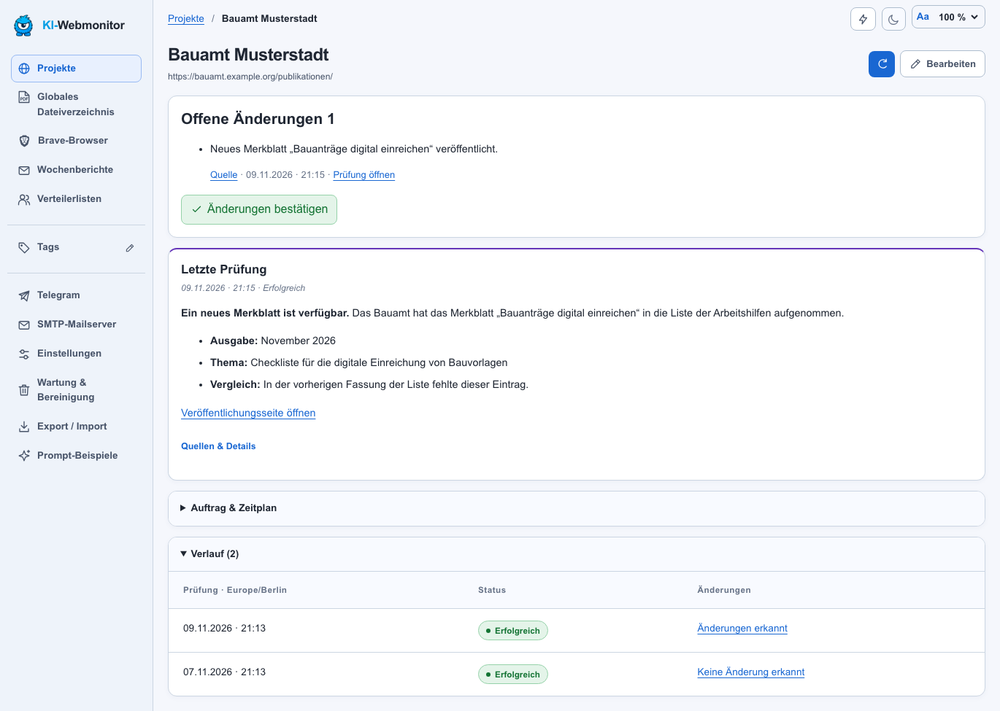
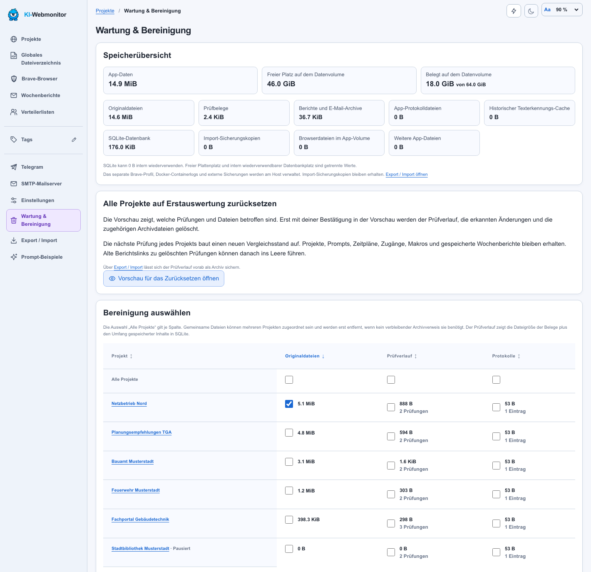

  

<h1 align="center">
  <picture>
    <source media="(prefers-color-scheme: dark)" srcset="docs/wordmark-dark.svg">
    
  </picture>
</h1>

<strong>Webseiten und Dokumente im Blick behalten</strong>

Der kostenlose KI-Webmonitor prüft Webseiten und verlinkte Dokumente nach einem Zeitplan. Pro Projekt legst du fest, welche Bereiche der Monitor prüft und welche Änderungen er meldet. Das Dashboard zeigt die Ergebnisse mit Quellen und Prüfverlauf. Heruntergeladene Dateifassungen bleiben im Archiv für den Vergleich verfügbar.

Web-App, Brave und Archiv laufen in Docker. Die KI-Auswertung nutzt einen erreichbaren Modellserver mit OpenAI-kompatibler API im privaten Netz, etwa [oMLX](https://github.com/jundot/omlx).

[Aktueller Release](https://github.com/adriantagonist87/KI-webmonitor/releases/latest) · [Installation](#installation) · [Projektprompt-Beispiele](docs/projektprompts/) · [Betriebsdetails](README.de.md)

*Die Screenshots stammen aus der App und verwenden fiktive Beispieldaten.*

## Ideen für eigene Projekte

Für Architektur und Technische Gebäudeausrüstung (TGA) in Deutschland bieten sich die Veröffentlichungsseiten von Behörden, Netzbetreibern, Fachverbänden und Verlagen an. Im Projektauftrag legst du fest, welche Dokumente, Fachmeldungen oder Artikel der Monitor erfassen soll. So kannst du die Auswahl auf ein Bundesland, ein Gewerk oder ein bestimmtes Bauvorhaben eingrenzen.

- **Gesetze und Bauvorschriften.** Verfolge Änderungen an Landesbauordnungen, Sonderbauverordnungen und Vorschriften zur Gebäudeenergie. Archiviere neu veröffentlichte Fassungen technischer Baubestimmungen und aktualisierte Bauantragsformulare. [Bundesrecht zur Gebäudeenergie](https://www.gesetze-im-internet.de/geg/) · [Technische Baubestimmungen beim DIBt](https://www.dibt.de/de/wir-bieten/technische-baubestimmungen)
- **Heizung, Lüftung, Klima und Sanitär.** Erfasse neue oder überarbeitete Planungsempfehlungen zu Wärmeversorgung, Kälteanlagen, Raumlufttechnik und Trinkwasserinstallationen. [Planungsempfehlungen des AMEV](https://www.amev-online.de/amevinhalt/planen/)
- **Elektrotechnik und Gebäudeautomation.** Beobachte neue Normausgaben und technische Hinweise zu Photovoltaik, Ladeinfrastruktur, Sicherheitsstromversorgung und Gebäudeautomation. Lass dir ausgetauschte Anschlussbedingungen oder Formulare deines Netzbetreibers melden. [Anschlussunterlagen von Stromnetz Berlin](https://www.stromnetz.berlin/partner/installateure/installateur-unterlagen/)
- **Architektur, Brandschutz und Bauphysik.** Sammle neue Arbeitshilfen zum barrierefreien Bauen, zum Schallschutz und zur Sanierung im Bestand. Prüfe, ob Feuerwehren Merkblätter zu Feuerwehrplänen oder anderen Vorgaben des vorbeugenden Brandschutzes aktualisieren. [Leitfaden Barrierefreies Bauen des Bundes](https://www.leitfadenbarrierefreiesbauen.de/) · [Merkblätter der Berliner Feuerwehr](https://www.berliner-feuerwehr.de/ihre-sicherheit/vorbeugender-brand-und-gefahrenschutz/)
- **BIM, Vergabe und Wettbewerbe.** Verfolge neue Ausschreibungen für Planungsleistungen, geänderte Vergabeunterlagen und neue Wettbewerbsauslobungen. Sammle überarbeitete BIM-Leitfäden und Vorlagen für Auftraggeber-Informationsanforderungen (AIA). [Muster-AIA bei BIM Deutschland](https://www.bimdeutschland.de/bim-wissen/auftraggeber-informationsanforderungen)
- **Fachartikel und Branchenmeldungen.** Sammle auf Fachportalen, Kammerseiten und in Zeitschriftenarchiven neue Beiträge zu Themen wie Wärmepumpen im Bestand, Holzbau, Förderung oder Honorarfragen. Der Wochenbericht bündelt die Treffer mit ihren Quellenlinks. [Meldungen aus dem Bundesbau](https://www.fib-bund.de/Inhalt/Neuigkeiten/)

## Installation

Der KI-Webmonitor läuft auf einem Linux-Docker-Host mit `amd64`. Alle drei Wege verwenden dieselben veröffentlichten Images und unterstützen den Zugriff per SSH-Tunnel oder im lokalen Netz.

| Installationsweg | Anleitung |
| --- | --- |
| **Portainer** | [Stack aus dem Release-Tag laden](docs/PORTAINER.md#testinstallation-aus-github) |
| **Dockhand** | [Git-Stack oder lokalen Stack im Editor anlegen](docs/DOCKHAND.md) |
| **Docker Compose** | [Projekt im Terminal einrichten und starten](docs/COMPOSE.md) |

Nach der Anmeldung unter **Einstellungen** die API-Adresse des Modellservers, bei Bedarf den Token und die Modelle eintragen und die Verbindung testen. Für Text, Tool Calling und Vision lassen sich getrennte Modelle wählen. Nichtleere KI-Vorgaben aus dem Stack haben Vorrang vor den Einstellungen der Weboberfläche. [Beispiel für Stack-Variablen](.env.example)

Mit einem festen `VERSION`-Wert beziehst du die fünf Images eines bestimmten Releases. In Dockhand kannst du mit `VERSION=latest` und **Re-pull images** beim Deploy den neuesten stabilen Release beziehen. [Dockhand-Update mit `latest`](docs/DOCKHAND.md#den-neuesten-release-mit-latest-beziehen)

## Ein Projekt einrichten

1. **Neues Projekt** wählen. Name, Start-URL, Tags und globalen oder individuellen Prüfzeitplan festlegen.
2. Im Prompt konkret beschreiben, **wo** der Agent suchen soll, **welche Inhalte** in den Prüfbereich gehören und **was** als Änderung zählt. Bei Menüs und Klappbereichen die sichtbaren Beschriftungen nennen. Erlaubte Hostnamen begrenzen die Webseiten, die das Projekt aufrufen darf.
3. Bei Bedarf die Anmeldung unter **Webseitenzugang** konfigurieren oder im grafischen Brave anmelden. Brave speichert die Sitzung im Browserprofil. Zugangsdaten gehören in die Zugangseinstellungen oder bei manueller Anmeldung direkt in den Browser.
4. Für eine Webseite mit mehreren Navigationsschritten unter **Browser-Makros** den Klickweg bis zur Zielansicht aufzeichnen, prüfen und für das Projekt speichern. Bei der nächsten Prüfung spielt Brave das Makro ab und übergibt der KI die erreichte Seite und das Klickprotokoll.
5. Die erste Prüfung über das Aktualisieren-Symbol starten und den erfassten Umfang prüfen. Der erste vollständige Lauf bildet den Ausgangsstand. Die Automatik lässt sich auf der Projektkarte pausieren und wieder einschalten.

> Prüfe den Abschnitt „Merkblätter“. Klappe jede Kategorie nacheinander auf und erfasse alle dort verlinkten PDFs. Melde neue Merkblätter und Dateien, deren SHA-256 sich unter derselben URL geändert hat. Nenne je Änderung den Titel und den Quellenlink. Führe nicht erreichbare Quellen gesondert auf.

Weitere Vorlagen gibt es in der App unter **Prompt-Beispiele**, in der Anleitung und als Textdateien im Repository. [Neue Webseiten einrichten](docs/PROJEKTE.md) · [Projektprompt-Beispiele](docs/projektprompts/) · [Screenshot der Makroansicht](docs/screenshots/browser-makros.png)

## Änderungen nachvollziehen

Das Dashboard filtert nach Tags und Prüfstatus. Ein erneuter Klick auf den aktiven Statusfilter führt zurück zu **Alle**. Ohne Statusfilter stehen laufende Prüfungen oben. Der Filter **Änderungen** pulsiert bei offenen Änderungen, die auf den hervorgehobenen Projektkarten mit dem grünen Häkchen quittiert werden können.

In der Projektansicht steht die fachliche Auswertung im Vordergrund. Bei Fachartikeln kann die KI zugängliche Texte zusammenfassen. Über den Verlauf erreichst du einzelne Prüfungen mit Quellen, Screenshots, technischen Unterschieden und Aktionsprotokoll.

### Dateien und Dateinachweise

Bei PDF-, Word- und Excel-Dateien lädt der Monitor die Originaldatei und berechnet ihren SHA-256-Hash. Ein anderer Hash belegt, dass sich die Dateibytes geändert haben. PDF- oder HTTP-Datumsangaben werden ergänzend ausgewiesen. Für die fachliche Prüfung stehen die archivierten Fassungen zum Download bereit.

Das **Globale Dateiverzeichnis** bietet Suche und Sortierung über Projekte hinweg, Dateigrößen in MB, einzelne Downloads und einen ZIP-Download mit einem Ordner je Projekt. Aus dem digitalen Text der ersten Seite kann die App den Dokumenttitel ermitteln. Diese Titelermittlung erfolgt getrennt vom Hashvergleich und ohne OCR.

## Benachrichtigungen und Wochenberichte

- **Telegram** meldet relevante Änderungen und Prüfprobleme. Die Automatik lässt sich global oder je Projekt steuern. Die Auswertung behält Absätze und Listen und verweist auf ihre Quellen.
- **E-Mail** liefert einen HTML-Bericht mit Textalternative. Unter **SMTP-Mailserver** lassen sich die Uhrzeit in `Europe/Berlin`, der Berichtszeitraum in Stunden oder Tagen und die Häufigkeit einstellen. Möglich sind tägliche, werktägliche, wöchentliche und monatliche Berichte sowie Stundenintervalle. Gespeicherte Einstellungen für SMTP und Telegram haben Vorrang vor den Stack-Vorgaben.
- **Bericht und Verteiler** zeigen relevante Änderungen und eine Übersicht der Quellen mit und ohne Änderungen. Pro geänderter Quelle führt ein Originalquellenlink zur Webseite mit dem Eintrag. Die Quellennamen verlinken die überwachten Websites. Empfängerberichte lassen sich nach Projekten oder Tags eingrenzen. Die Adminansicht bietet Vorschauen und ein Versandarchiv.

*Nachgestelltes Outlook-Nachrichtenfenster mit fiktiven Adressen.* [Bild in voller Auflösung](docs/screenshots/wochenbericht.png)

[Telegram und SMTP](docs/KOMMUNIKATION.md) · [Verteiler und Versandprotokoll](docs/VERTEILER.md)

## Wartung und Datensicherung

Unter **Wartung & Bereinigung** siehst du belegten und freien Speicher sowie Originaldateien, Prüfverläufe und Protokolle je Projekt in einer sortierbaren Tabelle. Bereinigungen lassen sich gezielt oder global auswählen und vor der Ausführung prüfen. Für einen neuen Ausgangsstand gibt es eine eigene Aktion mit Vorschau und Bestätigung.

Unter **Export / Import** kannst du die Projektkonfiguration als JSON oder zusammen mit dem Verlauf und den Archivdateien als ZIP exportieren. Eine Export-Passphrase schützt auf Wunsch gespeicherte Webseitenzugänge und die in der App hinterlegten oMLX-, SMTP- und Telegram-Zugangsdaten. Beim Import auf einer kompatiblen Installation kannst du Projekt- und App-Zugänge getrennt übernehmen. [Screenshot des geschützten Exports](docs/screenshots/geschuetzter-export.png)

Für eine vollständige Wiederherstellung sichere die persistenten Volumes einschließlich des Brave-Profils. [Sicherung, Wiederherstellung und Updates](docs/OPERATIONS.md)

## Zugriff und Prüfgrenzen

- **Webseitenzugriff.** Brave unterstützt JavaScript, Cookies und grafische Anmeldung. Der Agent kann Links, Klappbereiche und ausgewählte Bedienelemente nutzen. Bei erkanntem Bot-Schutz endet die Prüfung. Die nächste reguläre Prüfung bleibt geplant. CAPTCHAs und erforderliche manuelle Bestätigungen werden im Browser erledigt.
- **Prüfgrenzen.** Zeit, Anzahl der Seiten und Downloads sowie Dateigröße sind pro Lauf begrenzt. Das Ergebnis hängt vom sichtbaren Inhalt, der Webseitenstruktur und dem eingesetzten Modell ab. Unvollständige Prüfungen sind im Dashboard erkennbar.
- **Zugriff und Geheimnisse.** Den Stack per SSH-Tunnel oder im vertrauenswürdigen LAN mit Adminanmeldung betreiben. Zugangsdaten, API-Token, Browserprofile und Sicherungen gehören in private Speicherorte. Für öffentlichen HTTPS-Zugriff gelten die Einstellungen für den vorgeschalteten Proxy.

| Thema | Dokumentation |
| --- | --- |
| Umgebungsvariablen und Image-Build | [Beispiel für `.env`](.env.example), [erweiterte Variablen](advanced.env.example), [Release-Images bauen](docs/PORTAINER.md#github-und-registry) |
| Sicherung, Wiederherstellung und Updates | [Betrieb](docs/OPERATIONS.md) |
| Adminzugang und externer Zugriff | [Anmeldung](docs/ANMELDUNG.md), [Cloudflare Tunnel](docs/CLOUDFLARE.md) |
| Browser, Dienste und Netzgrenzen | [Architektur](docs/ARCHITEKTUR.md), [visuelle Brave-Bedienung](docs/VISUELLE-BROWSERBEDIENUNG.md) |

Der Quellcode steht unter der [MIT-Lizenz](LICENSE).
